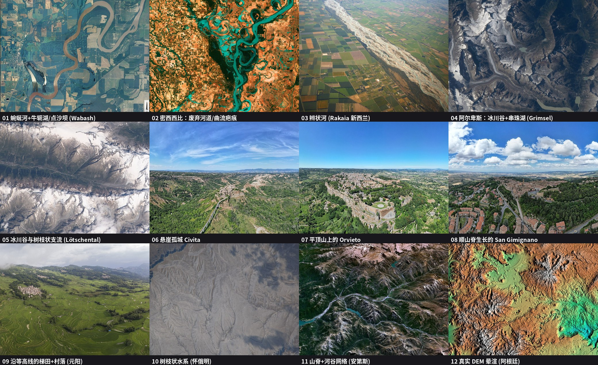
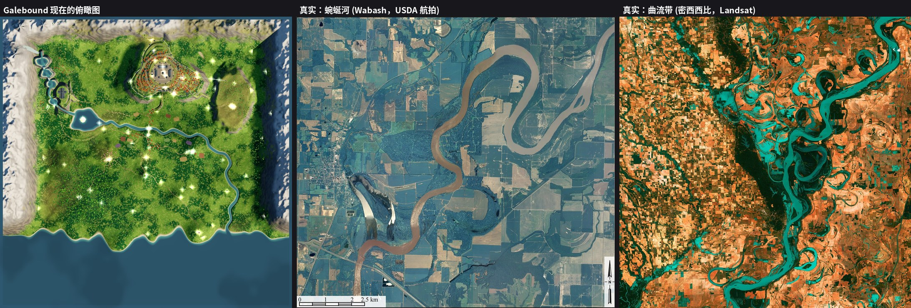

# Galebound 交接文档

这份文档是给接手本仓库的人或 AI 的入口。设计原稿仍在 [PLAN.md](PLAN.md)，但 **main 上的 PLAN.md 已部分过时**（画质原则、3A 目标、可进入的修道院等都还没写回去；这些内容目前在分支 `detail-lod-codex` 的 PLAN 更新里）。**先读本文，再读 PLAN，并以本文和所有者最近的决定为准。**

地形与河流的完整改造方案在 [docs/terrain-rework.md](docs/terrain-rework.md)，这是下一阶段最重要的工作，但必须等细节高模那一轮合并后再动手。

---

## 1. 项目是什么，要做到什么程度

Galebound（乘风）是一款部署在网页上的 3D 开放世界探索游戏。技术栈是 **Vite + TypeScript + Three.js（WebGL2）**。仓库：https://github.com/yangliyaole-cell/Galebound 。本文写作时 main 为 `c98e91c`（已合并到 PR #5）。

玩法很单纯：走路、奔跑、跳跃，并在阵风期从高处顺风跳下、张开双臂乘风滑翔；在世界里收集隐藏的光点。没有战斗。村民、羊、鸟和绝大多数建筑是装饰，让世界有生气。云瀑修道院（Cloudfall Abbey）现在可以走进去。

**总目标是一件 3A 级的艺术品。** 材质、光照、动画、地形和细节，都按接近 3A 的画面质量来做，不接受粗糙的低模、平涂色块、明显重复的纹理，也不接受「新手用毛笔画出来」的地形。所有视觉决策都按这个标准。

所有者是 Liyaole。合并且部署必须等他点头；每一次上线都要把 Cloudflare 和 Vercel **两边一起更新**。

在线地址：

- Cloudflare（主站，绑定自定义域）：https://galebound.cybcat.net
- Vercel 镜像：https://galebound.vercel.app  
  （学校网络只允许访问 `*.vercel.app`，所以镜像必须一直保留，不能只更新主站。）

---

## 2. 画质分档、风格开关、网址参数

### 画质三档（所有者 2026-11-13 定，后续一律遵守）

| 档位 | 原则 |
|---|---|
| **high** | 画面拉满，**不考虑性能和优化**。模型、纹理、阴影、后处理、植被密度、视距全部用最高配置。 |
| **medium** | 画面和性能兼顾。 |
| **low** | **唯一**做最低画质、照顾低端机的档。 |

不要为了低端机去压高画质。「注意性能」只适用于中、低两档。单个 Cloudflare Worker 脚本必须小于 3 MB；大文件放 `public/`，经 jsDelivr 加载。交付截图一律用 `q=high` 加 cinematic。

实现上，三档参数在 `src/core/quality.ts`。启动时若没有 `?q=`，会读 `localStorage` 键 `galebound.quality`，否则按设备自动选择（`auto`）。界面上的「画质」按钮会在 自动 / 低 / 中 / 高 之间循环。还有动态分辨率：帧率低于约 42 时降像素比，高于约 57 再升回来，`?dr=0` 可关掉。**这套自动降档和动态分辨率是历史实现，不要再把 high 档往低调。** 真正把 high 拉满（例如 2 m 地形网格、更密的草、更精细的阴影）是后续工作的一部分。

### 渲染风格

默认是 **cinematic（电影感）**。设置栏有「电影感」开关，状态存在 `localStorage` 键 `galebound.cinematic`（`'0'` 为关，缺省或 `'1'` 为开）。按 **V** 循环风格。

可用风格：`default`、`ghibli`、`cinematic`、`watercolor`、`lowpoly-dusk`。

### 常用网址参数

| 参数 | 作用 |
|---|---|
| `?q=low\|medium\|high` | 指定画质档 |
| `?style=default\|ghibli\|cinematic\|watercolor\|lowpoly-dusk` | 指定初始风格（优先于 localStorage） |
| `?effects=0` | 关掉电影感的采样泛光和深度 AO（low 档会自动关） |
| `?shot=1` | 截图模式：隐藏 HUD，冻结世界，固定随机种子，24 帧后设置 `window.__galeShotReady` |
| `?autostart=1` | 跳过标题页 |
| `?x=&z=&yaw=` | 出生点（`shot=1` 时忽略存档位置） |
| `?camyaw=&campitch=&dist=` | 相机（shot 默认朝北偏东看向城镇，距离 8.5） |
| `?gust=弧度` | 立即起风（shot 模式不生效） |
| `?dr=0` | 关闭动态分辨率 |
| `?hero=classic` | 使用旧的程序化主角，而不是 `public/models/traveler.glb` |
| `?mask=off` | 隐藏面罩 |

浏览器控制台：`window.__gale` 能拿到 `player`、`wind`、`follow`、`style` 等；`__gale.sim(秒数)` 可以快进；`__gale.style.current` / `await __gale.style.set('ghibli')` 可切换风格。

开着的斗篷 PR #6 还会增加 `?shot=cape&capemotion=idle|run|jump|glide|turn&capet=秒` 和 `__gale.capeStats()`。

---

## 3. 代码结构

入口是 `src/main.ts`：读参数、选画质、建渲染器、按顺序生成世界、挂主循环。

| 路径 | 职责 |
|---|---|
| `src/main.ts` | 启动、加载顺序、主循环、风格开关、调试句柄 |
| `src/core/quality.ts` | 三档参数、自动检测、动态分辨率 |
| `src/core/input.ts` | 键鼠、触屏摇杆、手柄；过滤指针锁定跳变 |
| `src/core/save.ts` | 光点与位置，写入 localStorage |
| `src/core/audio.ts` | 全部实时合成：风声、脚步、拾取、鸟鸣、环境旋律 |
| `src/player/controller.ts` | 走跑跳、游泳、滑翔起飞与转向 |
| `src/player/camera.ts` | 第三人称跟随，带碰撞收缩 |
| `src/player/character.ts` / `rig.ts` / `hero-model.ts` | 主角装配；默认加载 `traveler.glb` |
| `src/player/cloth.ts` | 滑翔用的臂上布条（链式布料）。全身斗篷软布料在 PR #6 的 `cape-sim.ts` |
| `src/render/styles/` | 风格预设与后处理管线（`cinematic.ts`、`pipeline.ts`、`effects.ts`、`types.ts` 等） |
| `src/render/toon.ts` / `textures.ts` / `uniforms.ts` / `glsl.ts` | 卡通材质、程序贴图、共享 uniform |
| `src/world/layout.ts` | 整张地图的坐标锚点：区域、手绘河道样条、道路、田地、山丘 |
| `src/world/mountain-layout.ts` | 高山湖、瀑布等西部山地锚点 |
| `src/world/heightmap.ts` / `noise.ts` / `terrain.ts` | 高度图生成、分块网格、高度纹理 |
| `src/world/water.ts` | 海、湖、河共用一张水平面（`y = 0`），这是河流看起来假的根因之一 |
| `src/world/grass.ts` | 实例化草和花；PR #5 已改为与地形网格一致的三角形插值 |
| `src/world/foliage.ts` / `scatter.ts` | 树和散布物。树木三档 LOD 在 `detail-lod-codex` |
| `src/world/sky.ts` / `wind.ts` / `flags.ts` / `maps.ts` | 天空云层、阵风、旗帜、地面 splat / biome |
| `src/world/orbs.ts` / `life.ts` / `colliders.ts` | 光点、村民与动物、2.5D 碰撞 |
| `src/world/build.ts` | 世界组装 |
| `src/world/abbey.ts` 路径实为 `structures/abbey.ts`；`abbey-space.ts` / `abbey-light.ts` | 可进入的云瀑修道院和室内光 |
| `src/world/structures/` | `house.ts`、`village.ts`、`city.ts`、`city-parcels.ts`、`city-terraces.ts`、`palace.ts`、`landmarks.ts`、`common.ts` |
| `src/ui/hud.ts` | HUD、标题、画质与电影感按钮 |
| `scripts/` | 回归检查，见下一节 |
| `tools/`、`art/hero/` | 主角 Blender 工程与导出 |
| `public/models/traveler.glb` | 主角模型（约 7.5 MB），不进 Worker 脚本，走 jsDelivr |

世界大约 2 km 见方。高度图目前在 high/medium 为 4 m 格，low 为 8 m。地形是运行时用值噪声 + 一层层 `lerp`/`smoothstep` 盖章生成的，**不是**先侵蚀再提取水系。

---

## 4. 构建与检查

```bash
npm ci
npm run dev          # 本地开发
npm run build        # tsc --noEmit && vite build，产物在 dist/
npm run preview
npm run check:grass  # 或 node scripts/check-grass-conform.mjs
node scripts/check-controls.mjs
node scripts/check-layout.mjs          # 还可加 --low / --high / --preview
```

上线前至少跑 `npm ci && npm run build` 和 `node scripts/check-controls.mjs`。改地形或草之后加跑 `check-layout` 和 `check:grass`。

风格截图脚本是 `scripts/capture-styles.mjs`，需要先起 dev/preview 服务器，再用 Playwright + Chrome（本环境常用 `playwright-core` + `/usr/bin/google-chrome` + SwiftShader）。SwiftShader 的毫秒数只能做相对比较，不能代表真机。用法见 `scripts/README.md`。

斗篷 PR 还会加入 `scripts/check-cape.mjs` 和 `scripts/check-cape-scene.mjs`。

---

## 5. 部署（每次必须两边一起更新）

仓库本身不带平台配置。合并到 main 并得到所有者同意之后，按下面做。**只更新一边，另一边就会落后。**

### 5.1 Cloudflare Worker

| 项 | 值 |
|---|---|
| 账户 ID | `7cab97c174358a99db83f9a89dd0a690` |
| Worker 名 | `galebound` |
| 域名 | https://galebound.cybcat.net |
| 套餐限制 | 免费版单个 Worker **脚本不超过 3 MB** |
| 兼容日期 | `2026-11-01`（`main_module: worker.js`） |

做法：

1. 在已更新到新 main 的克隆里执行 `npm ci && npm run build`。
2. 用仓库里的生成器重建 Worker 源码，并把 jsDelivr 钉到 **完整的 40 位 main SHA**（短 SHA 不要用）：

```bash
python3 scripts/gen-cf-worker.py \
  --sha $(git rev-parse HEAD) \
  --out worker.js \
  --deploy-js /tmp/gb_deploy.js
```

3. 生成器会把 `dist/` 里的文本文件（目前是 `index.html` 和 `dist/assets/*.js`）嵌进 `const FILES = {...}`，并写上：

```js
const CDN = 'https://cdn.jsdelivr.net/gh/yangliyaole-cell/Galebound@<full sha>/public';
```

`/models/*`（主要是 `traveler.glb`）由 Worker 向这个 CDN 地址做代理，并写入 `caches.default`，一天缓存。其它路径从 `FILES` 取；找不到且不是 `/assets/` 时回退到 `index.html`。`/assets/` 用一年不可变缓存，HTML 用 `no-cache`。

4. **不要把令牌、API key 写进生成结果或仓库。** `--deploy-js` 写出的包装脚本只是历史上用的 Cloudflare MCP `execute` 调用壳：

```js
async () => {
  const code = "...worker source...";
  const fd = new FormData();
  fd.append('metadata', new Blob([JSON.stringify({
    main_module: 'worker.js', compatibility_date: '2026-11-01'
  })], {type: 'application/json'}));
  fd.append('worker.js', new Blob([code], {type: 'application/javascript+module'}), 'worker.js');
  const r = await cloudflare.request({
    method: 'PUT',
    path: `/accounts/${accountId}/workers/scripts/galebound`,
    body: fd
  });
  return {ok: r.success, etag: r.result && r.result.etag, modified: r.result && r.result.modified_on};
}
```

`cloudflare` 和 `accountId` 由执行环境提供，文件里没有密钥。之前的手工脚本以 `/workspace/gb_deploy7.js` 为最新一份：解析旧脚本里的 `const code = "..."` 字符串，替换 `FILES`，再用正则替换 `Galebound@[0-9a-f]{40}`。新的 `scripts/gen-cf-worker.py` 直接从 `dist/` 重建，不必再改旧文件。也可用 Wrangler 上传 `worker.js`，同样不要把令牌提交进仓库。

如果生成器报脚本超过 3 MB，把大资源改放到 `public/`，经 jsDelivr 代理，不要继续往 `FILES` 里塞。

### 5.2 Vercel 镜像

站点：https://galebound.vercel.app

做法：把新的 `dist/` 拷进本地 Vercel 工程目录（历史上是 `/workspace/vercel/galebound`），**保留**该目录里已有的 `vercel.json` 和 `.vercel`，不要用 `dist` 覆盖掉它们，然后：

```bash
npx -y vercel@latest deploy --prod --yes
```

`vercel.json` 内容（SPA 回退，但不改写 `/assets/` 和 `/models/`）：

```json
{
  "cleanUrls": false,
  "rewrites": [
    { "source": "/((?!assets/|models/).*)", "destination": "/index.html" }
  ],
  "headers": [
    {
      "source": "/assets/(.*)",
      "headers": [{ "key": "cache-control", "value": "public, max-age=31536000, immutable" }]
    }
  ]
}
```

Vercel 会托管 `dist/models/traveler.glb`（构建时从 `public/` 复制过来），不必走 jsDelivr。

### 5.3 上线后核对

对两个域名都检查：

- 打开首页，必要时强制刷新（HTML 是 `no-cache`，旧的 hashed JS 可能还在缓存里）。
- 新的 `/assets/index-*.js` 返回 200。
- `/models/traveler.glb` 返回 **200**，`content-type` 为 `model/gltf-binary`。

---

## 6. 已经合并的历史（PR #2–#5）

更早还有 [PR #1](https://github.com/yangliyaole-cell/Galebound/pull/1)：镜头突然翻转修复，已在更早的 main 里。

| PR | 合并提交 | 内容 |
|---|---|---|
| [#2](https://github.com/yangliyaole-cell/Galebound/pull/2) | `ed66873` | 可切换渲染风格；电影感设为默认，并加「电影感」开关（`galebound.cinematic`） |
| [#3](https://github.com/yangliyaole-cell/Galebound/pull/3) | `84c6a2e` | 自然布局：弯曲道路、不规则山城与宫殿、湖与瀑布、可进入的云瀑修道院。说明见 `NATURAL_LAYOUT_REPORT.md` |
| [#4](https://github.com/yangliyaole-cell/Galebound/pull/4) | `f03b075` | 电影感近景阴影过黑的修复：hemisphere 0.85→1.5，地面色 0x4c6852→0x7f9f6c，vignette 0.44→0.30，foliageDark 提亮，新增后处理 `uToe`，主角环境贴图 `envMapIntensity 0.3`、`HERO_ALBEDO 0.75` |
| [#5](https://github.com/yangliyaole-cell/Galebound/pull/5) | `c98e91c` | 草贴地。根因是高度纹理半像素 UV 误差（再叠加半精度量化）。现改用与地形网格一致的三角形插值。全图约 85 万株草，修复前约 76% 离地超过 5 cm（最远约 22 m），修复后为 0。离中心越远的坡原来越秃，现已铺上 |

---

## 7. 尚未合并、正在做的工作

**未经所有者同意不要合并，也不要部署。**

### 7.1 PR #6 软斗篷（已开 PR，未合并）

- 地址：https://github.com/yangliyaole-cell/Galebound/pull/6
- 分支：`cape-cloth-codex`（已 rebase 到 main `c98e91c`）
- 新增 `src/player/cape-sim.ts`：Verlet 布料，带骨骼胶囊碰撞、风、惯性，并与滑翔衔接。
- 三档精度：low 117 点 / medium 375 点 / high 1125 点。检查序列里穿透为 0。
- 已知问题：斗篷颜色仍然接近纯黑，褶皱看不太清；要等材质/补光（A 线 PBR 与环境光）上来后才会明显改善。
- 性能：高画质下，无显卡的 Node 环境里整帧更新大约 **14.6 ms CPU**（求解本身约 9.7 ms）。按「high 档不考虑性能」可以接受，但仍建议真机看帧率。中、低档点数更少。
- 截图总览（17 帧，跑/跳/滑翔/转向）在交接机的 `/workspace/handoffs/galebound-detail/cape/contact-sheet.jpg`，不在本仓库里。

### 7.2 即将到来的 detail-lod-codex PR（还未开）

计划把下面三条线 rebase 进 `detail-lod-codex`，合成 **一个** PR 打到 main。这些分支都已推到 GitHub，但互相尚未合完，也还没对最新 main（`c98e91c`，含 #4、#5）做最终 rebase。

| 线 | 分支 | 内容 | 写作时状态（2026-11-13 下午，America/Chicago） |
|---|---|---|---|
| A | `detail-pbr-codex`（头在 `4eb7466`） | 程序化 PBR 材质库（粗石、砌石墙、灰泥、木、瓦、土路、苔藓、岩壁）、地形高度混合、PMREM 环境光、medium 双级联 / high 三级联阴影 | 第二轮截图已认为达标，等 B+C 结束后再 rebase 合入 |
| B+C | `detail-lod-codex`（头在 `3802e20`，第 4 轮当时还在跑） | 树木三档 LOD（近：独立叶片/叶簇；中：中多边形树冠 + 外层叶片卡片；远：外壳多边形）；门口石堆/石墙、城墙、城堡和大部分建筑改为程序化高模 | 第 3 轮后石堆仍像轴对齐方块，宫殿窗洞偏黑，故继续第 4 轮 |
| D | `detail-scenes-codex`（头在 `650978a`，第 3 轮当时还在跑） | 按三张参考图补场景：高崖山城、冰川与大瀑布、多拱长桥、近景拱门与苔石、红瓦村与田块 | 第 2 轮后山体仍偏大平面、瀑布不够显眼，故继续第 3 轮 |

参考图已收进本仓库：[docs/img/refs/](docs/img/refs/)。

**合并 A 线时必须做曝光复查。** PR #4 已经把 hemisphere 强度提到 1.5。A 线若再加 `scene.environment`（PMREM），两层叠在一起可能让草地发白。另外 `src/world/abbey-space.ts` 里室内半球光大约会再亮 **1.76 倍**，教堂室内必须在 cinematic + high 下重拍，防止过曝。不要改 `src/render/styles/` 里已上线的电影感参数来「抵消」，先在环境光与修道院光照这一侧处理。

最终 rebase 必须以当时的 `origin/main`（`c98e91c` 或更新）为底，不要仍以 `84c6a2e` 为底。`artifacts/` 里的非源码产物不要进 PR。

---

## 8. 已知问题（main 上仍然存在）

1. **俯瞰地形和河流看起来很假。** 这是视觉上最大的欠账，完整分析和改造方案见 [docs/terrain-rework.md](docs/terrain-rework.md)。简要结论：现在是在噪声底图上把河、山丘、城、修道院一个个盖上去；真实地形是先有坡度和水系，水流把地形雕出来。河是手绘样条，铺在 `y = 0` 的水平水面上，宽度几乎不变，没有支流和落差；地标坐在高斯小包或同心圆台地上，所以建筑旁边的凸起很突然。
2. **草可能长在建筑地基上。** PR #5 只修了贴地高度，没有做 footprint 掩码。重做地形时一并加一张建筑占地掩码，不要指望「生成新地图」会自动好。
3. **主角在逆光时脸是平的、缺少形体。** 还没修。
4. **没有在真机上系统测过性能。** 开发环境往往没有显卡，只有三角形数或 SwiftShader / Node 的毫秒数。
5. **main 上的 PLAN.md 落后于所有者的决定**：3A 目标、画质三档原则、可进入修道院、电影感默认等，应以本文和 `detail-lod-codex` 上的 PLAN 更新为准，合并那一轮时把 PLAN 一并改过来。
6. 其它仍写在 PLAN 里的旧问题：村民直线走、没有昼夜、灯塔顶部没有内部楼梯、主角模型较重（约 15.5 万三角面）。

---

## 9. 地形 / 河流重做（最重要的后续工作）

**开始条件：等 `detail-lod-codex` 那一个 PR 合并之后再动手。** 那一轮会改城、修道院、桥和部分 heightmap/layout；先重做地形会和它们打在一起，很难收场。所有者已经明确：先把草贴地做完（已上线），地形等那一轮合并后再重做。

方案正文、验收指标和实施顺序（P0 已完成，接下来是 P1 烘焙侵蚀底图 → P2 水系与河道 → P3 山城选址与地基过渡 → P4 道路和梯田 → P5 验收）都在：

**[docs/terrain-rework.md](docs/terrain-rework.md)**

对照图：

- 十二张真实样本拼图：
- 当前俯瞰 vs 真实样本：
- 单张样本： [docs/img/terrain-samples/](docs/img/terrain-samples/)
- 来源表： [docs/img/sources.json](docs/img/sources.json)

原则（请真正按这个做，不要再调一层噪声参数了事）：

- 生成顺序反过来：先粗底图和隆升场，再流量侵蚀 + 热侵蚀，再提取河网，再精修曲流/洪泛平原/牛轭湖，最后才在最终地形上选址和做地基挖填。
- 河必须由汇水面积长出来：越往下游越宽，支流以锐角汇入，水面沿流向单调下降，不再是 `y = 0` 的一张平面。
- 山城、风车、塔、修道院要坐在天然脊、孤丘或崖肩上，用 Dirichlet + 松弛做平滑过渡，禁止再盖高斯圆包。
- 高画质用烘焙高度图（建议离线 `scripts/bake-terrain.ts`，约 1025²、2 m），大文件放 `public/terrain/` 走 jsDelivr，以免撑破 Worker 的 3 MB 限制。中、低档降采样同一份数据，三档布局必须一致。
- 保持 `heightAt(x, z)` 和 `grid()` 的外部接口，并保留地标锚点（出生点、河谷村桥、高城、修道院、镜湖等，允许偏移见方案 §4.8），以减小和其它分支的冲突。

P0 草贴地已在 PR #5 完成。方案 §6 里关于「先修草」的段落可当历史来读；还没做的是建筑占地掩码，以及（可选）`texelFetch` 与 CPU `heightAt` 完全逐位一致的加固。

---

## 10. 建议的接手顺序

1. 读本文、把两个线上站点跑一遍（建议 `?q=high`，再对比关掉电影感），并读 [docs/terrain-rework.md](docs/terrain-rework.md)。
2. 审 [PR #6](https://github.com/yangliyaole-cell/Galebound/pull/6)。所有者同意后再 squash 合并，并按第 5 节同时更新 Cloudflare 与 Vercel。
3. 等 A / B+C / D 收束，rebase 到最新 main，合成 `detail-lod-codex` PR。合并前复查：教堂室内曝光、PMREM 与 hemisphere 1.5 叠加后的草地、high + cinematic 截图、Worker 脚本仍小于 3 MB。所有者同意后再合并并两边部署。
4. 把 PLAN.md 与 main 对齐（3A 目标、画质原则、当前进度）。
5. **这时才开始地形 / 河流重做**。建议先落地烘焙管线（P1），再水系（P2），再地基过渡（P3，顺手做草的建筑掩码）。
6. 主角逆光面部可与地形并行，但不要挡地形这条主线。

---

## 11. 参考图与署名

### 11.1 场景概念参考（所有者提供，用于细节与新场景）

收在 [docs/img/refs/](docs/img/refs/)，由原 PNG 压成 JPEG，每张小于 1 MB：

- `ref-spawn-castle-town.jpg` — 出生点近景：石拱门、纹章旗、苔石、碎石矮墙、羽扇豆、红瓦村与风车
- `ref-panorama-castle-abbey.jpg` — 全景：高崖山城、渡槽、峡谷长桥、左侧悬崖上的修道院与瀑布
- `ref-glacier-valley.jpg` — 冰川谷、蓝白冰舌、大瀑布与急流

这些是内部概念图，用来对齐场景，不是游戏内贴图。

### 11.2 真实地形与河流样本

拼图、对照图和 12 张单图来自 Wikimedia Commons，仅作改造地形时的内部参考。机器可读的出处见 [docs/img/sources.json](docs/img/sources.json)。

**公有领域**

| 文件 | 内容 | 作者 / 来源 |
|---|---|---|
| `01_meander_wabash.jpg` | 瓦巴什河曲流、牛轭湖、点沙坝 | USDA/FSA |
| `02_meander_mississippi.jpg` | 密西西比曲流带与废弃河道（Landsat 7） | USGS / NASA |
| `04_alpine_lakes_grimsel.jpg` | 伯尔尼阿尔卑斯冰川谷与串珠湖 | NASA（ISS） |
| `05_glacier_valley_lotschental.jpg` | Lötschental 冰川谷 | NASA（ISS） |
| `10_dendritic_wyoming.jpg` | 怀俄明树枝状水系 | NASA（ISS） |
| `11_dendritic_andes.jpg` | 安第斯山脊与河谷 | 公有领域 DEM 渲染 |
| `12_relief_dem_argentina.jpg` | 阿根廷 DEM 晕渲 | NASA Goddard |

**必须署名的 CC 作品（若对外发布或放入游戏，需按许可保留作者与许可声明，CC BY-SA 还要求同样方式共享）**

| 文件 | 许可 | 作者 | 来源页面 |
|---|---|---|---|
| `03_braided_rakaia.jpg`（新西兰 Rakaia 辫状河） | [CC BY-SA 4.0](https://creativecommons.org/licenses/by-sa/4.0/) | Andrew Cooper | [File:Rakaia River NZ aerial closer.jpg](https://commons.wikimedia.org/wiki/File:Rakaia_River_NZ_aerial_closer.jpg) |
| `06_hilltown_civita.jpg`（Civita di Bagnoregio） | [CC BY 4.0](https://creativecommons.org/licenses/by/4.0/) | BobTanGo | [File:Civita di Bagnoregio aerial panorama. June 2024.jpg](https://commons.wikimedia.org/wiki/File:Civita_di_Bagnoregio_aerial_panorama._June_2024.jpg) |
| `07_hilltown_orvieto.jpg`（Orvieto） | [CC BY 4.0](https://creativecommons.org/licenses/by/4.0/) | BobTanGo | [File:Orvieto_aerial_panorama._June_2024.jpg](https://commons.wikimedia.org/wiki/File:Orvieto_aerial_panorama._June_2024.jpg) |
| `08_hilltown_sangimignano.jpg`（San Gimignano） | [CC BY 4.0](https://creativecommons.org/licenses/by/4.0/) | BobTanGo | [File:Aerial_panorama_of_San_Gimignano_from_above._June_2024.jpg](https://commons.wikimedia.org/wiki/File:Aerial_panorama_of_San_Gimignano_from_above._June_2024.jpg) |
| `09_terraces_yuanyang.jpg`（元阳梯田） | [CC BY-SA 4.0](https://creativecommons.org/licenses/by-sa/4.0/) | Chensiyuan | [File:1_yuanyang_aerial_pano_2018.jpg](https://commons.wikimedia.org/wiki/File:1_yuanyang_aerial_pano_2018.jpg) |

`docs/img/contact.jpg` 和 `docs/img/compare_topdown_vs_real.jpg` 是上述样本的拼图/对照，因此同样受其中 CC 图片的署名义务约束。其中的 Galebound 俯瞰截图是本项目自己的画面。

**不要把这些参考图直接当成游戏内纹理使用。** 它们是学习真实地形长什么样的样本。

---

## 12. 其它约定

- 合并到 main 请用 squash，且必须有所有者明确同意。
- 不要把密钥、Cloudflare / Vercel / npm 令牌、`.vercel` 目录或 `node_modules` 提交进仓库。
- 大二进制（主角 GLB、以后的烘焙高度图）放 `public/`，不要塞进 Worker 脚本。
- 中文沟通对象是 Liyaole；对用户说话请用简体中文，简洁清楚。
