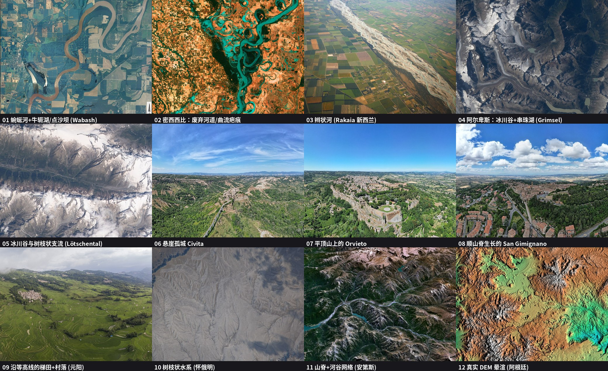
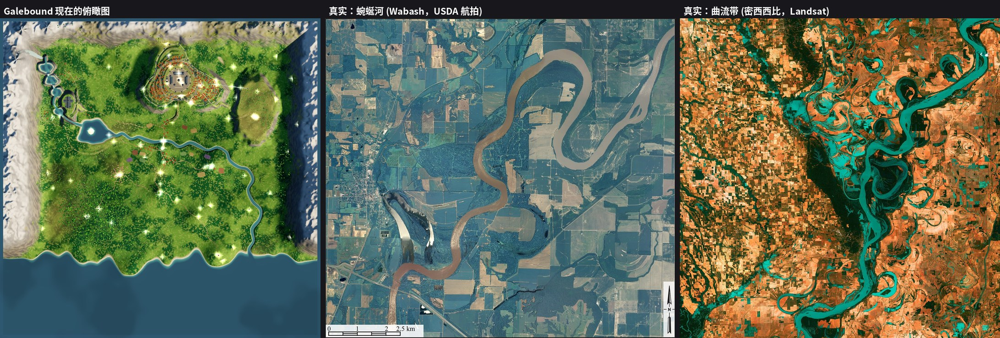

# Galebound 地形 / 河流 / 聚落：真实样本对照与改造方案

> **交接状态（2026-11-13，America/Chicago）**
>
> - 下文是对照真实俯瞰样本后写下的改造方案。调研当时代码读自全新克隆，main 为 `f03b075`（PR #4 电影感近景阴影）。
> - **P0 草贴地已经上线**：见 [PR #5](https://github.com/yangliyaole-cell/Galebound/pull/5)，已合并到 main `c98e91c`。根因是高度纹理的半像素 UV 误差。全图约 85 万株草上，修复前约 76% 离地超过 5 cm（最远约 22 m），修复后为 0。
> - **仍未解决**：草还可能长在建筑地基上，因为没有 footprint 掩码。放到本方案的地基过渡和草排除规则里一起做，不要指望生成新地图时自动修好。
> - **P1 及之后的地形 / 河流重做，必须等 `detail-lod-codex`（程序化 PBR / PMREM、树木三档 LOD、高模建筑、参考图新场景）合并之后再开始**，因为它会改到城、修道院和桥。
>
> 完整样本图在 [`img/terrain-samples/`](img/terrain-samples/)（`01`…`12`）；拼图与对比图如下。来源、许可和作者见文末「样本来源与许可」，机器可读表在 [`img/sources.json`](img/sources.json)。CC BY / CC BY-SA 的图片（03、06、07、08、09）仅作内部参考；对外发布或放进游戏需按许可署名。





---

## 1. 一句话结论

我们现在的世界是「在一张分形噪声底图上，一个一个往上盖章」：河是一条画上去的样条线，山丘是以建筑为中心的高斯小包，城市台地是同心圆，修道院是一块被抹平的椭圆。
真实地形是反过来的：**先有整体坡度和水系，水流把地形雕出来；河、谷、脊、聚落都是这个水系的产物**。所以我们看起来像「新手用毛笔画」，不是参数问题，是生成顺序反了。

---

## 2. 真实样本里反复出现的规律

（编号对应图片文件；数值是地貌学里的经验值，用来当参数初值，不是精确定律。）

### 2.1 河流
| 规律 | 看哪张图 | 经验值 / 做法 |
|---|---|---|
| 曲流河不是随机拐弯，而是**近似正弦生成曲线**，拐弯越来越大直到自我裁弯取直 | 01、02 | 曲流波长 ≈ **10–14 倍河宽**；弯曲半径 ≈ 2–3 倍河宽；蜿蜒度（河长/谷长）>1.5 才叫曲流 |
| 河留下**历史痕迹**：牛轭湖、废弃河道、点沙坝（弯内侧一圈圈弧形条纹） | 01、02（02 里青绿色的新月形、涡旋形全是废弃河道） | 平原段必须有 2–6 个牛轭湖/疤痕，沿河两侧 5–15 倍河宽范围内分布 |
| **断面不对称**：弯外侧陡深，弯内侧缓浅（沙坝） | 01 | 深泓线向外侧偏移，内侧做缓坡沙洲 |
| 河谷底是**平的**，河在里面游走；谷边有突然抬升的阶地/崖 | 01、02、03 | 洪泛平原宽度 ≈ 5–15 倍河宽，坡度 <0.5° |
| 山前冲积扇/冰水平原上是**辫状河**：多条浅河道，砾石滩，河道每隔一段分合 | 03 | 只出现在「坡度中等、泥沙多、河宽大」的河段，比如冰川出山口 |
| 河**越往下游越宽**，有支流汇入后明显变宽 | 02、11 | 河宽 ∝ 流量^0.5，流量 ∝ 汇水面积（上游面积） |
| **支流以锐角汇入**（夹角朝下游），形成树枝状水系，不会平行并排也不会 90° 垂直交汇 | 10、11、12 | 汇流角约 45–75°；支流数量随河宽成层级（Horton/Strahler） |
| 河的纵剖面是**下凹曲线**：上游陡、下游缓，没有一段是水平的 | 04、05、11 | 坡度 S ∝ 汇水面积 A^(-0.45)（凹度 θ≈0.45） |
| 冰川谷里的湖是**串珠式**：一级一级台阶，每个湖在一个被冰刨深的盆地，湖口出去是陡坡/瀑布 | 04 | 湖在 U 形谷底；湖间用台阶连接；出口处才有瀑布/急流 |

### 2.2 山地与水系
| 规律 | 看哪张图 | 做法 |
|---|---|---|
| 山脊和山谷**由水系决定**：每条脊线夹在两条沟之间，沟呈树枝状汇聚到主谷，脊线连续不断 | 10、11、12 | 用流量侵蚀（stream power）生成，不要用各向同性噪声 |
| 沟的间距大致均匀（排水密度），小沟汇大沟，大沟汇主谷 | 10 | 侵蚀迭代自然得到 |
| 山顶陡、坡脚缓，**坡脚有倒锥形堆积（岩屑/冲积扇）**，不是一刀切 | 04、05、12 | 热侵蚀（thermal erosion）：坡度 >35° 的岩屑往下滑 |
| 主谷底宽而平，被冰川刨过的谷是 U 形 | 04、05 | 在西部雪山主谷用 U 形剖面修正 |
| 等高线是**连续、平滑、彼此近乎平行**的曲线；很少出现孤立的圆包 | 12 | 避免「高斯包」，改成沿山脊延伸的山鞍/支脊 |

### 2.3 聚落与地形的关系
| 规律 | 看哪张图 | 做法 |
|---|---|---|
| 山城**坐在天然地形上**：悬崖孤丘（06 Civita 周围是密集的冲沟）、平顶孤山（07 Orvieto 一圈 30–50 m 的垂直崖，崖脚是植被覆盖的岩屑坡）、山脊上的长条城（08 San Gimignano，沿脊线生长） | 06、07、08 | 选址在**支脊鼻/孤山**，不是在平地上堆一个圆台 |
| 城的外轮廓**由崖线决定**，而不是由圆形城墙决定；城墙顺崖沿线布置 | 06、07 | 城区边界 = 崖肩线（用带噪声的 SDF），崖外才是陡坡 |
| 只有 1–2 条上山路，路沿等高线盘旋（之字形） | 06、07、08 | 路坡度 ≤ 8–12%，转弯用「发卡弯」 |
| 台地/梯田**顺着等高线**，每一级是一条细长弯曲的带，坡缓处宽、坡陡处窄；村子坐在缓坡肩部，上方是林地 | 09 | 梯田沿等高线生成，田埂挡墙高度由相邻两条等高线高差决定 |
| 单栋房子的地基是**小范围挖填 + 毛石挡墙**，周围地形平滑过渡，不会出现「圆形平台突起」 | 07、08 | 见 §4.4 |
| 房屋长轴多平行于等高线，沿路排成不规则带，而不是放射状 | 08 | 朝向 = 等高线切线方向 ± 随机 |

### 2.4 整体观感（俯瞰）
- 真实俯瞰图里**没有一块区域是单调的**：田块大小不等、边界斜着切、河谷里颜色分带、山体阴影有明显的脊—沟节奏（见 10、11、12）。
- 我们的俯瞰图（`compare_topdown_vs_real.jpg` 左）：河宽几乎不变、像一根管子；曲率幅度均匀；没有任何支流；湖是一个椭圆；四周山脉像**四面直边的框**（见 3.3），中间是平铺的绿色噪声。

---

## 3. 当前代码的具体问题（对照 `src/world/`）

### 3.1 河流（`layout.ts`、`heightmap.ts`、`water.ts`）
1. **河是画上去的样条，不是流出来的。** `layout.ts:99` `RIVER` 是 28 个手写控制点 + Catmull-Rom 样条。`heightmap.ts:15–18, 28, 54–56` 用「到折线距离」把地形压平再往下挖。河道位置与地形坡向无关，所以河会穿过本该是山脊的地方（地形图里河谷看不出来）。
2. **河宽与水系无关。** `layout.ts:114` `riverWidthAt = 8.3 + 2.1·sin(x·0.019+z·0.014)+1.5·sin(...)`，只是 x、z 的正弦，上游下游一样宽；没有支流，也没有汇流变宽。
3. **水面是一块水平面。** `water.ts:23` 注释「One flat sheet for sea, lake and river」，`mesh.position.y = WATER_LEVEL (0)`。整条河（从镜湖到出海口，长约 1000 m）水面都在海拔 0，河床就是个沿海平面的沟，**没有纵向落差，没有流向**。真实河必须单调下降。
4. **没有洪泛平原结构。** 只有 `lerp(3+(h-3)*0.18, h, sstep(25,170,dr))`（`heightmap.ts:28`）一个压平，没有河漫滩、阶地、牛轭湖、点沙坝、裁弯取直。
5. **湖是椭圆。** `layout.ts:106–113` `lakeMetric` 椭圆 + 三个正弦扰动；真实的湖岸跟地形等高线走（冰碛湖是细长的、河成湖是新月形）。
6. **高山湖/溪流也是折线盘**：`mountain-layout.ts` 四个固定椭圆湖 + 130 点 Catmull 曲线，直接 `lerp` 到 `bed`（`heightmap.ts:103–113`），所以湖盆和溪床像模具压出来的。
7. **海岸线**是 `545 + fbm + 24·sin(x/47) + 12·sin(x/23)`（`heightmap.ts:58`），两个周期固定的正弦——俯瞰图上能看到规则的波浪边。

### 3.2 地形底图（`noise.ts`、`heightmap.ts`）
1. 底图 `fbm` 是**值噪声**（`noise.ts`），有格点各向异性，没有脊/沟结构；`heightmap.ts:24` 只是 `fbm(x/260,…)*36 + fbm(x/70)*6`，**没有侵蚀、没有 ridged、没有 domain warp**，因此永远不会出现树枝状水系。
2. 四周山脉是用 `band(edge,width)`（`heightmap.ts:20, 70–80`）做的矩形带 + fbm 抬高，所以俯瞰图四周是**直线边框**；3 座冰川角峰是 `pow(1-d,1.45)` 的锥体（`heightmap.ts:82–85`）。
3. **所有高度都是 `lerp(h, 目标值, smoothstep)` 层层覆盖**（共 8 处），每一层都会在边界产生坡度突变；它们互相叠加后难以预测。

### 3.3 「凸起」：建筑下面的地形台座（用户最不满意的地方）
这是「建筑旁边凸起很突兀」的直接原因：
1. **以地标为圆心的高斯小丘**：`layout.ts:27–40` `HILLS` / `LATE_HILLS` 的中心恰好是 START、WINDMILL、WATCHTOWER、BLOSSOM、LIGHTHOUSE…（`heightmap.ts:44–47, 61–64`：`h += hill.h·exp(-d²/r²)`）。真实的风车/瞭望塔建在**自然高地**上，不是先放建筑再在它脚下凸一个对称的包。
2. **石阵高地**（`PLATEAU`，`heightmap.ts:49–52`）是椭圆 + `sstep(0.7,1.05)` 一圈抬升 46 m，所以俯瞰图东边是一块「圆润的馒头」。
3. **城市**：`heightmap.ts:34–42, 88–95` 用 `CITY.top`、`sstep(CITY.plateau, CITY.hill, dc)` 把整座山做成同心圆；5 级台地由 `cityTerraceMetric`（径向 r）决定，等高线是「圆 + sin 扰动」，不是顺地形的曲线。`heightmap.ts:42` 还把半径 84–103 m 内**强行拉平到 CITY.top+5**。
4. **修道院**：`heightmap.ts:97–101` 椭圆内 `lerp(h, ABBEY.floor, 1-sstep(0.82,1.3,abbeyD))`，加一条 `Math.max(h, floor*approach)` 的南向引道条带——一块被硬抹平的盘子加一条硬填的堤。
5. **房屋**（`structures/house.ts:60–66`）：地形不动，房子取脚下 4 角最低点 `lo` 往下挖 2 m 的石基 `b.box('stone', …, lo-2, …)`，在坡上就变成一个突出的石头盒子，而不是地形顺势挖填。

### 3.4 草不贴地（另记，见 §6）

---

## 4. 改造方案

### 4.0 总体管线（生成顺序要反过来）

```
①  粗底图  (256² / 8 m)    ←  地标约束 + 隆升场 + 海岸
②  侵蚀雕刻 (流量侵蚀 + 热侵蚀 + 冰川修正)  ← 水系在这一步“长出来”
③  水系提取 (汇水面积、河网、湖、瀑布)  ← 河由此得到，不是画的
④  河道精修 (曲流、洪泛平原、牛轭湖、辫状段)  ← 只在平缓河段
⑤  聚落选址 + 建筑地基 (挖填 + 平滑过渡)  ← 在最终地形上放东西
⑥  道路 (最小代价路径，沿等高线) + 路基挖填
⑦  上采样到 2 m + 细节噪声(ridged) + 小尺度热侵蚀
⑧  烘焙：高度图 R16/R32 + 水面高度图 + 流向图 + 坡度图 + 建筑/道路掩码
```
**执行位置**：强烈建议**离线烘焙**（`scripts/bake-terrain.ts`，Node 里跑，固定随机种子），产物是一个 1025²（2 m）的 16 位高度图二进制（约 2 MB，压缩后约 1 MB）+ 水面/掩码小图，放在仓库 `public/terrain/` 经 jsDelivr 加载（和现在 `traveler.glb` 的做法相同，规避 Cloudflare 免费版 3 MB 限制）。理由：高画质「拉满」的规则下，侵蚀可以用高分辨率、几百次迭代，不占用玩家加载时间；结果完全确定，不会因为浮点/设备差异在各设备上长得不一样。离线失败时的兜底：运行时用 ① 加简化 ② 在 Web Worker 里生成 256² 低精度版。

### 4.1 底图与侵蚀（解决「山不像真山」）
- 把 `fbm`（值噪声）换成**梯度噪声（simplex/Perlin）**，叠 **ridged multifractal**（`1-|n|` 平方）+ **domain warping**（用另一组噪声扰动采样坐标，幅度 ~ 0.3–0.5 倍波长）。
- 四周山脉不再用矩形带，改为**隆升场 U(x,z)**：西部高（雪山）、东北较低，边缘用距离场 + 噪声扰动；边界不再是直线。
- **流量侵蚀 stream power**：`dh/dt = U − K·A^m·S^n`，m≈0.5、n=1。用 Braun & Willett (2013) 隐式法，每次迭代是 O(N)（先用 priority-flood 填洼地得到下游顺序，再按顺序扫描）。分辨率 512²（4 m）、100–200 次迭代，Node 里几秒。结果自动得到：树枝状水系、等间距山脊、凹形纵剖面。
- **热侵蚀**（坡度 > 35° 的物质滑到下游）5–20 次，得到坡脚岩屑裙；作用于山脚和崖脚。
- **西部雪山冰川化**：对主谷做 U 形剖面（`h' = 谷底 + (h−谷底)^p` 的谷壁抬升），在谷底挖 4 个超深盆地做串珠湖（与现有 `ALPINE_LAKES` 位置保持一致，湖间用台阶，出口留瀑布位置 `WATERFALLS`）。
- 局部「液滴水力侵蚀」（≈30 万水滴、每滴 30 步）只在上采样后的 2 m 网格上做**细节**，不改变大水系。

### 4.2 河流（解决「河不自然」）
1. **河由水系提取**：对 ② 的结果算 D8（或 D-infinity）流向、汇水面积 A。取 A 大于阈值的格子为河网。镜湖作为一个**固定水位的洼地**（priority-flood 保证它有溢出口）；出海口在现有位置（x≈610, z≈665）附近。
2. **保持玩法位置**：河仍要穿过「河谷村」桥（20,−242）。做法是在 ① 里加一条**弱引导沟**（宽 200 m、深 6–10 m 的低洼走廊）连接镜湖→村→海，侵蚀自然把河收到这个走廊里；取不到时再允许 ±40 m 的偏移，桥/路按最终河位置自动重算。
3. **河宽**：`w = 3.0·A^0.4`（A 以 km² 计，系数标定到源头 ~3 m、出海口 ~25–35 m），逐点写入，下游单调变宽；**支流汇入处**收束后变宽，形成冲刷潭。
4. **曲流（只在坡度 <1.5° 的下游段启用）**：对流向得到的中心线，用 **sine-generated curve**（Langbein–Leopold：偏转角 θ(s) = ω·sin(2πs/λ)，ω ≈ 60–110°，λ = 12·w）重建中心线，再用 **Howard–Knutson 曲流迁移模型**迭代数十步，让弯越来越大并发生**裁弯取直**，被切下的弯留作**牛轭湖**（浅水、新月形）。
5. **河道断面**（垂直中心线）：抛物线 `d(n) = D·(1−(n/w)²)`；深泓向弯外侧偏移 0.2–0.3·w；弯内侧加点沙坝（缓坡 + 条纹）；河岸两侧做 0.3–0.8 m 的天然堤，再向外缓降到洪泛平原。
6. **洪泛平原**：沿中心线 5–15·w 内高度向「河谷底面」收敛，用平滑最小/Laplace 松弛得到，不要 `lerp 到常数`。平原边缘留阶地崖（1–3 m）。
7. **辫状段**：冰川出山口（西部山脚）和镜湖入口处，在 3–6 个横向偏移的子河道上叠加 ridged 噪声，每隔 4–8·w 合并一次，滩地用砾石材质。
8. **水面**：不再是 y=0 的一张面。生成 **水面高度图**（R16F，与高度图同分辨率）：`水面 = 河床 + 水深`，沿流向严格单调不增（离线烘焙时做一次「下行取最小」扫描）。水面网格用河道带状网格 + 高度图采样；`water.ts` 的深度/泡沫改读水面高度图。湖面是该湖盆的固定水位；瀑布 = 水面高度图在出口处的陡降（现有 `WATERFALLS` 位置作为强制 knickpoint）。
9. **海岸线**：不再用正弦。使用**高程切割**：海平面 0 与最终高度图相交；海岸沿等高线，附近用一点热侵蚀+噪声得到湾、岬、沙嘴（河口做三角洲扇形）。

### 4.3 山城选址（解决「城是圆台」）
- 把高城放到**一条支脊的鼻部/一座孤丘**上：在 ① 里于 (120,−640) 附近用「带噪声的 SDF」塑一个**平顶孤丘 + 崖带**（参照 07 Orvieto、06 Civita）：崖肩线 = 城墙多边形（现有 29 顶点）外扩 5–12 m 再做 domain warp；崖高 20–45 m、坡度 55–75°，**崖面按水平地层加台阶**；崖脚用热侵蚀得到岩屑裙；城顶用大尺度平缓穹隆而不是 `CITY.top+5` 的平面。
- 只留 1–2 个入口方向（南门、东门），路用 4.6 的最小代价路径通往。
- 城内台地：不用 `cityTerraceMetric`（径向 r），改为在**城顶平滑高度场上每隔 Δ=3–4 m 取等高线**，沿这些等高线布置街道；台阶高度 >1.2 m 的地方放毛石挡墙。这样街道和台地天然是弯的、不同心。
- 同理：风车丘、瞭望塔、灯塔、启程丘不要再 `+exp(−d²/r²)`，改为在最终地形上**搜索附近局部最高点/支脊鼻**（半径 80–150 m 内），把建筑点移过去。

### 4.4 建筑地基与“台座”过渡（直接对应用户痛点）
对每个地基 footprint（城市约 360 栋、村庄、塔、风车）：
1. **目标高度** `T` = footprint 内平均高度（限制挖/填 ≤ 1.5 m；超过则整体退台或换位置）。
2. **Dirichlet 约束 + Laplace 平滑松弛**：把 footprint（外扩 0.5 m）内的格子固定为 `T`，footprint 外的一圈（带宽 `R`）做 30–60 次 Jacobi/共轭松弛，使过渡是**调和的**（没有拐角，没有圆形边缘）。
3. **过渡半径** `R = clamp( |Δh| / tan(φ), 2 m, 18 m )`，φ = 土质安息角 ≈ 28–32°（有挡墙时放宽到 60°）；用 smoothstep(0,1,t) 而不是线性。
4. 坡度大于 ~25° 时，下坡一侧放**毛石挡墙**（高度 = 台面与下坡自然地面差），挡墙与 `buildTerraceWalls` 复用；地基石盒子（`house.ts` 里 `lo−2`）改为 `max(自然地面) − 台面` 的实际高差。
5. **整条街/整个地块**作为一个整体做挖填（不是逐栋），避免每栋都出一个小台。
6. 房屋朝向：长轴取地形等高线切线方向（`atan2` 梯度的垂直方向）±0.25 rad 噪声，间距用泊松盘采样，而不是放射状。

### 4.5 梯田与农田（解决「田太规整」）
- 坡度 <8° 的平缓处：**不规则四边形斑块田**（Voronoi + 边缘噪声 + 随机旋转 ±35°，参考 03、09 的田块配色），田块之间留田埂/小路。
- 坡度 8–25° 的坡面：**等高梯田**。取最终高度图的等高线（Δ=1.5–2.5 m），每级台面平整、前缘做 0.6–1.5 m 的挡坎；梯田宽度由坡度自动决定。
- 河漫滩里的田块受洪泛平原约束：长边平行河流。

### 4.6 道路
- 在最终高度图上算**坡度代价栅格**（代价 ∝ 1 + (S/0.10)²，水体不可穿越，桥位置单独指定），用 A*/Dijkstra 跑「城门→河谷村→风车→修道院…」各条路，再用 Chaikin/B 样条平滑；坡度 >12% 的段自动生成**之字形发卡弯**（在两个交点间人为加一对反向弯）。
- 路基：与 4.4 同一套 Dirichlet+松弛（路宽 + 肩 1.5 m），取代现有 `gradeRoadbeds` 里的 max-heap 传播（见 `heightmap.ts:134–197`，可保留思想：路心高度单调、横坡 ≤ 2%）。

### 4.7 采样/网格
- 高画质：2 m（1025²，约 105 万顶点）。`terrain.ts` 现为 128 m 分块，每块 4 m→32 格；2 m 需要 64 格/块；**远处分块做 LOD（4/8/16 m）+ 裙边防裂缝**（`createTerrain` 已按块组织，改动局部）。
- 中画质：4 m 采样同一份高度图；低画质：8 m。**同一份烘焙数据降采样**，保证三档布局一致。
- 画质原则（`docs/PLAN.md`）：高画质不为性能让步；低画质才是最低配。因此 2 m 网格、水面高度图、流向图全开在高档。

### 4.8 保持现有地标大致位置
把下面作为**锚点约束**（①、③ 里用作固定高度/强制位置，⑤ 里用作放置参考），验收时检查实际位置偏移：

| 地标 | 现位置 | 允许偏移 | 约束 |
|---|---|---|---|
| 出生点 START | (0, 100) | ±15 m | 缓坡丘顶，视野朝北见城堡 |
| 河谷村 + 桥 | (20, −230)/(20, −242) | 桥随河位置自动重算 | 河在此处是较直河段 |
| 高城/宫殿 | (120, −640)，top ≈ 104+5 | ±30 m | 孤丘+崖带，宫殿在最高点 |
| 云瀑修道院 | (−600, −495)，floor 64 | ±20 m | 悬崖肩部台地，下方瀑布 |
| 镜湖 | (−430, −300) | ±40 m | 固定水位洼地 + 溢出口 |
| 4 个高山湖 + 4 道瀑布 | `mountain-layout.ts` | ±30 m | 串珠湖，出口 knickpoint |
| 风车 / 瞭望塔 / 灯塔 | (340,−80)/(250,250)/(380,505) | 允许在 150 m 内换到自然高地 | |
| 石阵高地 | (620, −450) | ±60 m | 自然的方山/台地（侵蚀残丘） |

### 4.9 性能预算（高画质拉满）
- 运行时新增：下载并解码一个 ~2 MB 的高度图（+ 水面图 ~1 MB 级别）。
- 烘焙：Node 里跑，估计 1–3 分钟（可接受，不在游戏加载路径）。
- GPU：高度/水面图为 R16F/R32F 纹理，各 2 MB 量级；地形顶点 ~105 万，分块 LOD 后实际绘制顶点 <30 万。
- 内存：1025² 的 Float32 高度图 4 MB，可忽略。

---

## 5. 验收指标（自动化，加到 `scripts/`）

| 检查 | 通过标准 |
|---|---|
| 河纵剖面 | 水面高度沿流向**单调不增**；总落差 >8 m |
| 河宽 | 沿流向单调不减（汇入处允许跃升），下游宽度/上游宽度 ≥ 3 |
| 曲流参数 | 下游平原段蜿蜒度 1.4–2.0；曲率过零点测得波长 / 河宽在 9–15 |
| 水系 | 至少 6 条支流；汇流角度分布 90% 在 40–80° |
| 地基过渡 | 任一地基外 `R` 范围内最大坡度 ≤ 35°，相邻格高差二阶差分（拉普拉斯）无 >0.6 m 的尖峰 |
| 无圆形台座 | 以地标为圆心 r∈[20,150] m 内，地形的高度径向对称度（方位角标准差/平均）≥ 0.15 |
| 地标位置 | 上表偏移全部在允许范围内；起点→城堡可见 |
| 道路 | 所有道路最大纵坡 ≤ 14%，横坡 ≤ 3%，无穿水 |
| 视觉 | 俯瞰图 + 晕渲图并排对比 `contact.jpg` 里 01/10/12 |

---

## 6. 已知 bug：草有时贴不住地形（浮空 / 陷进地里）

### 6.1 结论（根因）
草的高度来自**一张和地形网格不一致的高度纹理**，而不是地形本身。有三个叠加的原因，按影响大小：

**(A) 纹理采样有半个像素 + 缩放错位（主因）。**
- `heightmap.ts:228–236` 的 `createHeightTexture()` 建了一张 **(n+1)×(n+1)** 的纹理（n = SIZE/cell = 512，所以 513×513），顶点 i 对应世界 x = i·cell − 1024。
- 草的着色器 `grass.ts:42/80` 用 `worldUv(xz) = xz/SIZE + 0.5` 采样，也就是把世界 [−1024, 1024] 映射到 uv [0,1]。但是 513 个像素中心在 uv = (i+0.5)/513，**不是 i/512**，于是采样到的像素下标 = `gx·513/512 − 0.5`（gx 为网格坐标）：
  - 地图中心附近误差为 0；
  - **越往边缘，水平偏移越大，左边 −0.5 格、右边 +0.5 格**（cell=4 m 时最大 ±2 m），在 30° 坡上就是 ±1.15 m 的竖直误差。
- 所以出生点附近看起来正常（刚好在中心），城堡（x≈120, z≈−640）、修道院、雪山脚下、海边都会明显浮空或陷地。这也解释了「有时候」。

**(B) 双线性插值 ≠ 地形网格的三角形剖分。**
- 地形网格用 (a,c,b),(b,c,d) 两个三角形（`terrain.ts:172`），CPU 的 `heightAt()`（`heightmap.ts:204–218`）也精确按这个三角形插值（`fx+fz<=1`）。
- 草的着色器靠硬件 `LinearFilter` 做**双线性**（`heightmap.ts:231–233`），在非平面格子上与三角形结果不同，崖边/陡坡处最大差 4 m（实测）。

**(C) 半精度浮点。**
- 纹理是 `HalfFloatType`（`heightmap.ts:230–231`），高度 >64 m 时精度 ≥ 6 cm，>128 m 时 ≥ 12 cm，>256 m 时 ≥ 25 cm。城堡（top≈109 m）、雪山的草/花都会有厘米级到分米级抖动。草根只往下压了 0.05 m（`grass.ts:105`），完全掩盖不了。

**(D) 次要因素。**
- 叶片是**直立的四边形**，只在叶片中心采样一次高度；`grass.ts:25–46` 的远景叶片宽 1.6 m，陡坡上两端会一边悬空一边陷地（±0.8 m × 坡度）。
- 法线用 ±3 m 差分（`grass.ts:88–91`）作为光照法线，但**几何没有按法线倾斜**。
- 排除条件用的是烘焙在 `uBiome.a` 里的「平坦度」（`grass.ts:92`），不是实际坡度；道路/田地来自 2048² 的 splat 贴图（1 px/m）的双线性混合，边缘有半透明过渡，叶片会长到路肩上。
- 水：`step(0.25, ground)` 只针对海平面，高山湖靠 `lakeLevel()` 的椭圆近似（`terrain.ts:14–17`），与实际湖盆边缘不一致。
- 建筑地基：草没有「建筑占地」掩码，会穿出石基。
- `flowers`（`grass.ts:201`）同样的 uv，也受 A、B、C 影响。水面 `water.ts` 用同一张 `heightTex` 算深度，浅滩会同样偏移。

### 6.2 我用代码模拟了 shader 的采样，量化如下
在仓库的真实高度图（cell=4，主 CPU `heightAt` 作基准）上，随机取 20 万个点（海拔 0.5–95 m，即允许长草的范围），比较「shader 实际会采到的高度」与地形网格高度：

| 方案 | 偏差 >5 cm 的比例 | >25 cm | >1 m | p95 | 最大 |
|---|---|---|---|---|---|
| **现状**（半精度 + `uv=x/SIZE+0.5` + 双线性） | **59.3 %** | 31.3 % | 13.4 % | 1.74 m | 18.7 m |
| 只修 uv 半像素（其余不变） | 4.8 % | 0.7 % | 0.09 % | 0.05 m | 4.5 m |
| 修 uv + Float32 | 3.5 % | 0.7 % | 0.08 % | 0.03 m | 4.4 m |

（这是 CPU 对 shader 数学的模拟，不是 GPU 实测；剩余的 3.5 % 是双线性 vs 三角形剖分，集中在陡坡/崖边，用 §6.3 的 texelFetch 方案可降到 0。）
意味着：**大约六成草根的位置高度跟地面不一致，其中约 1/8 差一米以上**，主要在远离地图中心的地方。

### 6.3 修复方案（与新地形管线同步做；其实可以先于地形改造单独发）
1. **草、花、水面只读最终高度场**。新地形（侵蚀、河道、地基挖填、路基）全部在烘焙阶段写进同一个 `grid().data`，再生成纹理；运行时**不允许任何系统再改地形**（现在 `gradeRoadbeds` 也在 `buildHeightmap` 里，保持这一点）。
2. **纹理改为 R32F + NearestFilter + `texelFetch`，在着色器里复刻三角形插值**（与 `heightAt` 同一公式）：
```glsl
uniform sampler2D uHeight;   // R32F, NearestFilter, 无 mipmap
uniform float uCell;         // 与 terrain 网格同一个 cell
uniform int   uN;
float terrainHeight(vec2 xz) {
  vec2 g = clamp((xz + 1024.0) / uCell, vec2(0.0), vec2(float(uN) - 1e-3));
  ivec2 i = ivec2(floor(g)); vec2 f = g - vec2(i);
  float a = texelFetch(uHeight, i, 0).r;
  float b = texelFetch(uHeight, i + ivec2(1,0), 0).r;
  float c = texelFetch(uHeight, i + ivec2(0,1), 0).r;
  float d = texelFetch(uHeight, i + ivec2(1,1), 0).r;
  return (f.x + f.y <= 1.0) ? a + (b-a)*f.x + (c-a)*f.y
                            : d + (c-d)*(1.0-f.x) + (b-d)*(1.0-f.y);
}
```
   这样与 `terrain.ts` 的网格、`heightAt()` 逐位一致。（WebGL2 的 R32F 不需要 float-linear 扩展，因为是 Nearest。）
3. **叶片每个顶点各自采样地面**：底边两个顶点用各自的 xz 调 `terrainHeight`，中/上排顶点在「法线与竖直之间 0.6 混合」的方向上抬升。远景大叶片（1.6 m 宽）就不会一端悬空。
4. **用同一个三角形算出的精确法线**做倾斜和光照，不用 ±3 m 差分。
5. **排除规则**（全部在着色器里用「最终」数据）：
   - 坡度：`1 − n.y > 0.45`（≈ 33°）淡出到 0，并用**真实法线**而不是 `uBiome.a`。
   - 道路/广场/田地：splat 掩码向外**膨胀一个叶片宽度**再判断，并在 splat 画布生成时给路肩多画 1 m。
   - 水：读新的**水面高度图**，`ground < water + 0.3` 时不长草（岸边 0.3–1.2 m 湿润带渐隐）。
   - 建筑/地基：烘焙一张 2048² 的 R8 **建筑占地掩码**（footprint 外扩 1.5 m），草在掩码内为 0。
6. 草根下沉量从 `−0.05` 改为 `−0.02`（配合精确采样不再需要掩盖误差）。

### 6.4 自动化检查：偏差 >5 cm 的草实例计数
新增 `scripts/check-grass-conform.mjs`（`npm run check:grass`），分两层：

**层 1：CPU 复刻（快，几秒，可进 CI）**
- 在 Node 里 `buildHeightmap(…)`，用与 shader 完全相同的纹理量化（Float32/Half）和采样公式，按和 `createLayer` 完全一致的 `aCell` 种子生成实例，对 N 个玩家位置（出生点、高城、修道院、高山湖、地图四个角、河口）求 `base = terrainHeight_shaderModel(root)` 并与 `heightAt(root)` 比较。
- 判定：`allowed` 的实例里 `|Δ| > 0.05 m` 的比例必须 ≤ **0.1 %**；`> 0.25 m` 的必须为 **0**；输出每个玩家位置的计数表。（我上面的脚本已经是这个雏形，当前会失败：59 %。）

**层 2：GPU 真值（防止 shader 和 CPU 模型漂移）**
- 在页面里加调试开关 `?grassaudit=1`：用与草相同的顶点着色器代码（共享 GLSL 片段，**不要复制粘贴一份**）渲染 `gl.POINTS`，每个 `gl_InstanceID` 写到一个 RGBA32F 渲染目标的第 id 个像素：`(root.x, root.z, baseY, allowed)`；
- Playwright/Chromium（Codex 已用 SwiftShader 截图）里 `readPixels`，再用页面里的 `heightAt` 比较，输出同样的计数。
- 判定同层 1；再额外统计「`allowed` 但坡度 > 33°」「`allowed` 但在 splat 路面 > 0.3」「`allowed` 但在水下」的实例数，全部要求为 0。

---

## 7. 实施顺序（建议）

| 阶段 | 内容 | 依赖 / 风险 |
|---|---|---|
| P0 | **草贴地修复**（§6，包含 `check:grass`） | 独立，几小时，可立刻上线；不依赖地形重做 |
| P1 | 烘焙管线：梯度噪声 + ridged + 隆升场 + stream-power 侵蚀 + 热侵蚀；地标锚点 | 最核心；需要 Node 可跑，三档降采样 |
| P2 | 水系提取 + 河宽 + 曲流/洪泛平原/牛轭湖 + 水面高度图 + 高山串珠湖/瀑布 + 海岸 | 改 `water.ts`、桥/路位置重算 |
| P3 | 山城孤丘 + 地基挖填（Dirichlet+松弛）+ 街道/台地沿等高线；地标改选自然高地 | 与 Codex 正在做的高模/新场景分支有重叠（城、修道院、桥），需先对齐分支 |
| P4 | 道路最小代价路径、梯田/田块、LOD 分块 | |
| P5 | 验收指标（§5）全绿 + 前后俯瞰对比图 | |

> 注意：Codex 现有几条分支（高模 / 树 LOD / 新场景 / 材质）都会读 `heightAt()` 并改城市、修道院、桥等位置。新管线保持 `heightAt(x,z)` 与 `grid()` 的**接口不变**，只换内部实现，并保留一份 `landmarks.ts`（上表）作为共同的锚点，冲突会小很多。

---

## 8. 样本来源与许可

| 文件 | 内容 | 来源页面 | 许可 / 作者 |
|---|---|---|---|
| 01_meander_wabash.jpg | 蜿蜒河、牛轭湖、点沙坝（Wabash，伊利诺伊） | https://commons.wikimedia.org/wiki/File:Wabash_River_Meanders_Grayville,_Illinois.jpg | 公有领域（USDA/FSA） |
| 02_meander_mississippi.jpg | 密西西比曲流带，废弃河道/疤痕（Landsat 7） | https://commons.wikimedia.org/wiki/File:Meandering_Mississippi_(5182095595).jpg | 公有领域（USGS/NASA） |
| 03_braided_rakaia.jpg | 辫状河 + 田块（Rakaia，新西兰） | https://commons.wikimedia.org/wiki/File:Rakaia_River_NZ_aerial_closer.jpg | CC BY-SA 4.0，Andrew Cooper |
| 04_alpine_lakes_grimsel.jpg | 阿尔卑斯冰川谷+串珠湖（ISS 拍摄，Grimsel 一带） | https://commons.wikimedia.org/wiki/File:ISS074-E-833852_-_View_of_Switzerland_-_Bernese_Alps_-_Aargletscher_-_valley_Haslital_-_Guttannen_-_Grimselpass_-_Gelmersee_-_Grimselsee_-_R%C3%A4terichsbodensee_-_Aargrat_-_Oberaarsee_-_Galmigletscher_-_Gauligletscher_-_Gaulisee_(cropped).jpg | 公有领域（NASA） |
| 05_glacier_valley_lotschental.jpg | 冰川谷、支流树枝状沟（ISS，Lötschental） | https://commons.wikimedia.org/wiki/File:ISS067-E-152533_-_View_of_Switzerland_-_L%C3%B6tschental_valley_-_Lonza_-_Blatten_-_Wiler_-_Kippel_-_Bietschhorn_-_glacier_Nestgletscher_-_Langgletscher_-_L%C3%B6tschenl%C3%BCcke_-_Oberaletschgletscher_-_Anengletscher_-_Tschingelhoren_(cropped).jpg | 公有领域（NASA） |
| 06_hilltown_civita.jpg | 悬崖孤城 Civita di Bagnoregio，周围冲沟 | https://commons.wikimedia.org/wiki/File:Civita_di_Bagnoregio_aerial_panorama._June_2024.jpg | CC BY 4.0，BobTanGo |
| 07_hilltown_orvieto.jpg | 平顶山上的 Orvieto，崖带 + 岩屑坡 | https://commons.wikimedia.org/wiki/File:Orvieto_aerial_panorama._June_2024.jpg | CC BY 4.0，BobTanGo |
| 08_hilltown_sangimignano.jpg | 沿山脊的 San Gimignano，路沿等高线 | https://commons.wikimedia.org/wiki/File:Aerial_panorama_of_San_Gimignano_from_above._June_2024.jpg | CC BY 4.0，BobTanGo |
| 09_terraces_yuanyang.jpg | 沿等高线的梯田 + 村落（元阳） | https://commons.wikimedia.org/wiki/File:1_yuanyang_aerial_pano_2018.jpg | CC BY-SA 4.0，Chensiyuan |
| 10_dendritic_wyoming.jpg | 树枝状水系（ISS 看怀俄明） | https://commons.wikimedia.org/wiki/File:ISS018-E-11132_-_View_of_Wyoming.jpg | 公有领域（NASA） |
| 11_dendritic_andes.jpg | 山脊与河谷网络（安第斯，渲染的真实 DEM 影像） | https://commons.wikimedia.org/wiki/File:Andes_70.98343W_35.78028S.jpg | 公有领域 |
| 12_relief_dem_argentina.jpg | 真实 DEM 晕渲 + 高度着色（阿根廷） | https://commons.wikimedia.org/wiki/File:Argentina_(4691434734).jpg | 公有领域（NASA Goddard） |

CC BY / CC BY-SA 的图片仅作内部参考；若要放进游戏内或对外发布，需按许可署名（上表已有作者）。
